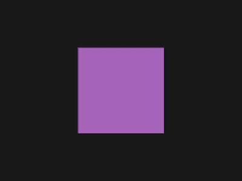
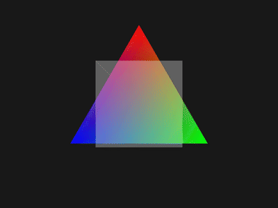

# renderer

Software rasterizer in Rust, based on tsoding's [olive.c](https://github.com/tsoding/olive.c). Everything gets drawn into a `Vec<u32>` of pixels, no GPU and no graphics crates. Xlib on Linux and Win32 GDI on Windows are only used to show the buffer in a window.

<p align="center">
  
  
</p>

```sh
cargo run --release                                    # cube, esc or q to quit
cargo run --release -- triangle
cargo run --release -- cube --ppm frame.ppm --time 2.5 # single frame to a file
cargo test
```

`cargo build --no-default-features` builds without a window (only `--ppm` works then), that's what the headless CI step uses.

## Layout

- `src/canvas.rs` - canvas, set_pixel with alpha blending, rect, circle, bresenham line, triangles, ppm output
- `src/math.rs` - Vec2, Vec3, Mat3 rotations
- `src/color.rs` - 0xAARRGGBB colours, blend, mix, shade
- `src/demos.rs` - triangle and cube
- `src/main.rs` - args and the frame loop
- `src/event.rs` - Event and Key, shared by both window backends
- `src/window_x11.rs`, `src/window_win32.rs` - `renderer::window`, same API per platform: open_window, poll_event, should_quit, present, close_window. My flappy and physics sandbox use it too

## Notes

Triangles use edge functions. For each pixel centre in the bounding box, `edge(a, b, p) = (b - a) x (p - a)` for all three edges. If they're all positive the pixel is inside, and dividing by the area gives barycentric weights, which is how the rgb gradient works.

Shared edges use the top-left rule so a pixel on the edge between two triangles only gets drawn once. Without it the see-through square has a brighter line down the diagonal.

Rotation always starts from the original points with the total angle. My first version rotated the previous frame's rounded i16 points by a small step each frame and the triangle slowly shrank.

The cube is rotated, back-face culled, flat shaded and divided by z for perspective. It's convex so there's no depth buffer yet.

## Todo

- [ ] depth buffer
- [ ] textures
- [ ] text
- [ ] wasm build
